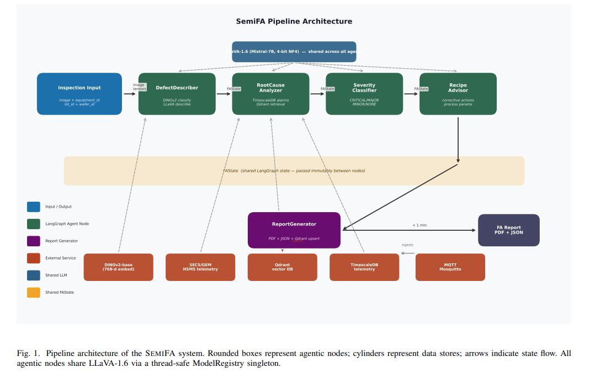
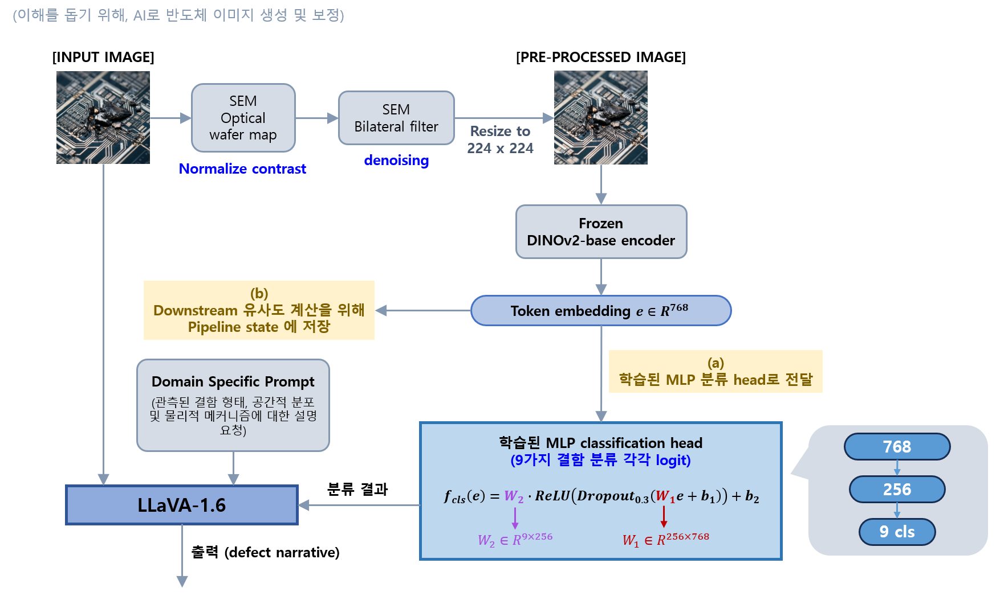

## 목차

* [1. 논문 개요](#1-논문-개요)
* [2. 시스템 구조](#2-시스템-구조)
  * [2-1. DefectDescriber](#2-1-defectdescriber)
  * [2-2. RootCauseAnalyzer](#2-2-rootcauseanalyzer)
  * [2-3. SeverityClassifier](#2-3-severityclassifier)
  * [2-4. RecipeAdvisor](#2-4-recipeadvisor)
  * [2-5. ReportGenerator](#2-5-reportgenerator)
* [3. 인프라 구조](#3-인프라-구조)
* [4. 데이터셋](#4-데이터셋)
* [5. 실험 및 그 결과](#5-실험-및-그-결과)
  * [5-1. 결함 분류](#5-1-결함-분류)
  * [5-2. 파이프라인 지연 (latency)](#5-2-파이프라인-지연-latency)
  * [5-3. 멀티모달 모델에 대한 Ablation Study](#5-3-멀티모달-모델에-대한-ablation-study)
  * [5-4. 질적 연구 (Case Study)](#5-4-질적-연구-case-study)
* [6. 논의 사항](#6-논의-사항)
* [7. 결론 및 향후 연구 과제](#7-결론-및-향후-연구-과제)

## 논문 소개

* Shivam Chand Kaushik, "SemiFA: An Agentic Multi-Modal Framework for Autonomous Semiconductor Failure Analysis Report Generation", 2026
* [arXiv Link](https://arxiv.org/pdf/2604.13236)

## 1. 논문 개요

본 논문의 핵심 사항은 다음과 같다.

| 핵심 사항        | 설명                                                                                                                                 |
|--------------|------------------------------------------------------------------------------------------------------------------------------------|
| 시스템 구조 `C1`  | 4개의 에이전트를 포함한 LangGraph 파이프라인 - **반도체 FA (불량 분석)** 과제를 **특화된 sub-task로 분해**                                                     |
| 멀티모달 퓨전 `C2` | 다음 3가지 항목을 **LLaVA-1.6 컨텍스트** 로 통합 - `DINOv2` 모델의 Visual Embedding - SECS/GEM 장비와의 통신을 통한 데이터 - Qdrant 를 통한 기존 수집된 데이터 추출 |
| 데이터셋 `C3`    | **SemiFA-930** 데이터셋 - 930개의 annotation 된 반도체 불량 이미지로 구성 - 총 class 개수는 9개                                                     |

## 2. 시스템 구조

SemiFA 는 **LangGraph를 이용하여 구성된, 5개의 node로 된 파이프라인** 이다.

* node 구성
  * 처음 4개의 node는 **AI Agent** (domain-specific prompt 적용 + 도구 호출 가능한 VLM 기반)
  * 마지막 5번째 node는 **구조적인 report 생성**
* Shared state
  * typed dictionary 인 `FAState` 를 shared state로 하여, 각 node 간 통신 

[(출처)](https://arxiv.org/pdf/2502.01013) : Shivam Chand Kaushik, "SemiFA: An Agentic Multi-Modal Framework for Autonomous Semiconductor Failure Analysis Report Generation"

| node               | 역할                                                                  | 입력 데이터                                               | 출력 데이터                                         |
|--------------------|---------------------------------------------------------------------|------------------------------------------------------|------------------------------------------------|
| DefectDescriber    | 이미지에서 탐지된 **결함에 대한 설명** 생성                                          | `inspection image`                                   | `결함 설명` `결함 유형` (+ `CLS 토큰 임베딩`을 파이프라인에 저장) |
| RootCauseAnalyzer  | 결함의 **근본적인 원인** 에 대한 가설 생성                                          | `장비 통신 데이터` `과거 데이터 retrieval` `결함 설명` `결함 유형`       | `근본 원인 가설`                                     |
| SeverityClassifier | 결함의 **심각성 분류** (심각성 등급 출력)                                          | `inspection image` `결함 설명` `결함 유형`                   | `심각성 등급`                                       |
| RecipeAdvisor      | **결함 수정을 위한 행동** (공정의 파라미터 조정안 포함) 생성                               | 지금까지의 모든 데이터 (`결함 설명` `결함 유형` `근본 원인 가설` `심각성 등급` 등) | `결함 수정 행동`                                     |
| ReportGenerator    | 결함에 대한 dictionary 생성 후, 해당 dictionary를 **PDF 문서로 변환 (= PDF 문서 생성)** | 지금까지의 모든 파이프라인의 출력 결과                                | `결함 보고서`                                       |

### 2-1. DefectDescriber

**DefectDescriber** 는 다음과 같은 4단계 연산을 수행한다.

* **1.** 입력 이미지 전처리 (contrast 정규화, denoising, resize)
* **2.** 768차원의 CLS token embedding 생성
* **3.** (Wafer map 이미지 한정) **rule-based 기반 패턴 분석기** 를 이용하여 결함 밀도, 방향 및 각도 분포 계산
  * defect의 특정을 나타내기 위한 보충적 feature로 활용
* **4.** inspection image 및 분류 결과를 **LLaVA-1.6** 으로 전달 후, LLaVA-1.6은 최종적으로 **결함에 대한 설명 (defect narrative)** 생성

### 2-2. RootCauseAnalyzer

**RootCauseAnalyzer** 는 다음 3가지 데이터 소스에서 얻은 데이터를 이용하여, **결함의 근본적인 원인에 대한 가설** 을 생성한다.

| 데이터 소스                                   | 설명                                                                                                                                                                         |
|------------------------------------------|----------------------------------------------------------------------------------------------------------------------------------------------------------------------------|
| SECS/GEM 장비와의 통신 (telemetry) 을 통해 얻은 데이터 | 최근 알람 이벤트, 공정 변수 측정값 등 - **TimescaleDB** 라는 DB로부터, PostgreSQL을 이용하여 추출                                                                                                  |
| 과거 데이터 추출 (retrieval)                    | DINOv2 모델에 의한 **768차원 임베딩** (DefectDescriber 부분) 을 Qdrant DB에 호출하여, **코사인 유사도** 기반으로 **가장 가까운 5개의 이전 결함 케이스** 추출 - 이들 defect case 정보는 **결함 유형, 심각성, 근본 원인 분석 결과** 등을 포함 |
| LLaVA 모델의 추론                             | `위 2가지 데이터 소스` + `결함 분류 결과` + `결함에 대한 설명`을 **구조화된 프롬프트** 로 구성하여, LLaVA-1.6 모델에 추론 요청 - LLaVA-1.6 모델은 **근본 원인에 대한 가설의 ranked list** 생성                                   |

### 2-3. SeverityClassifier

**SeverityClassifier** (심각성 분류기) 는 결함 정보를 입력받아서 심각성 등급을 출력한다.

* 결함 정보
  * inspection image
  * 결함 분류, 결함 설명
  * 결함에 대한 **근본 원인에 대한 가설** (root cause hypotheses)

* 심각성 등급

| 심각성 등급     | 설명                     | 예상 생산량 영향도     |
|------------|------------------------|----------------|
| `CRITICAL` | wafer scrap, 장비 손상 등   | 25% 초과         |
| `MAJOR`    | 공학적 문제 해결 필요           | 5% 초과 - 25% 이하 |
| `MINOR`    | 일반적인 수준 (당장 문제 해결 불필요) | 5% 이하          |
| `NONE`     | 결함 없음                  | -              |

### 2-4. RecipeAdvisor

**RecipeAdvisor** 는 **결함 수정을 위한 행동 추천 + 공정의 파라미터 조정안** 을 생성한다.

* RecipeAdvisor 의 입력 데이터는 **지금까지의 모든 데이터** 이다.
  * 결함 유형, 결함 설명, 결함의 근본 원인 분석 가설, 심각성
  * 장비와의 통신 (telemetry) 을 통해 얻은 정보
  * 과거 유사 사례들 (historical precedents)

### 2-5. ReportGenerator

**ReportGenerator** 는 **지금까지의 파이프라인의 모든 출력 결과** 에 대해 다음과 같이 처리한다.

* 구조화된 dictionary 로 변환
* Report Lab 이라는 오픈소스 라이브러리를 이용하여 PDF 문서로 변환

ReportGenerator 가 생성한 보고서에는 다음 정보들이 포함된다.

* 메타데이터 (장비 ID, lot ID, wafer ID, timestamp 등)
* 결함에 대한 정보 (결함 분류 및 분류 결과에 대한 confidence score, 근본 원인 분석 및 관련 근거, 심각성 분석 등)
* 결함에 대한 해결 방안 (공정 개선 방안 등)

## 3. 인프라 구조

## 4. 데이터셋

## 5. 실험 및 그 결과

### 5-1. 결함 분류

### 5-2. 파이프라인 지연 (latency)

### 5-3. 멀티모달 모델에 대한 Ablation Study

### 5-4. 질적 연구 (Case Study)

## 6. 논의 사항

## 7. 결론 및 향후 연구 과제
