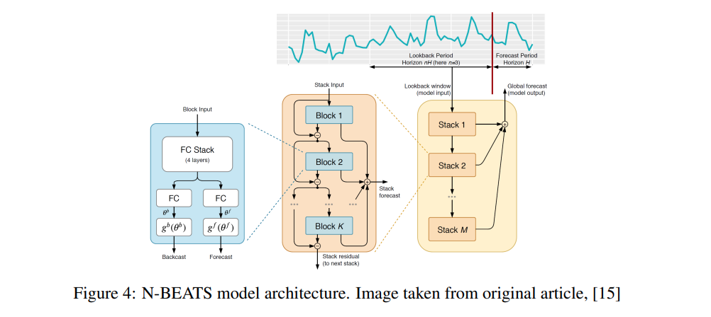
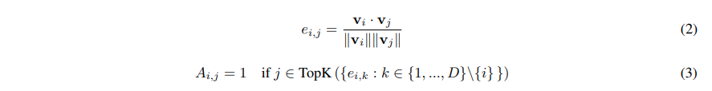
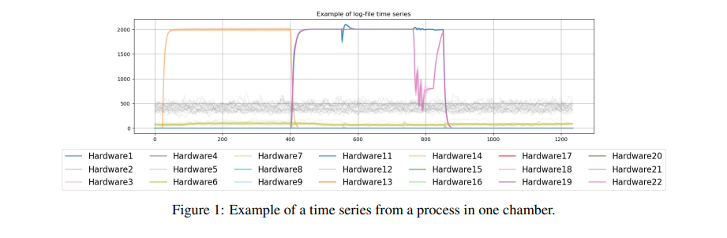
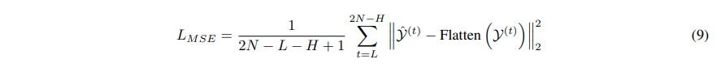
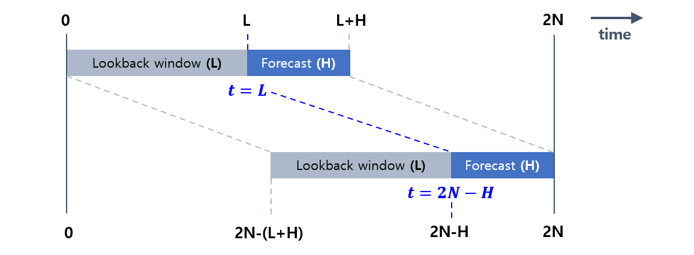
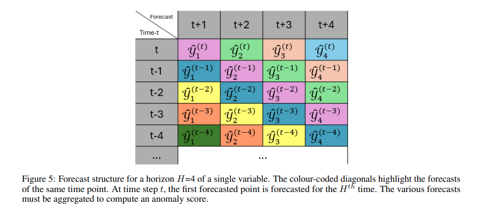
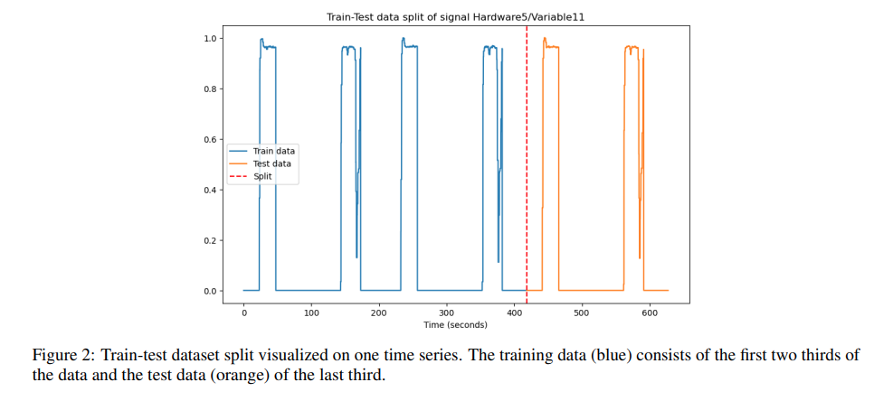
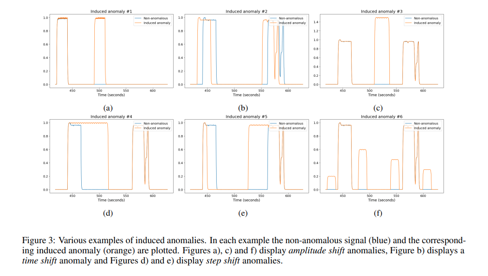

## 목차

* [1. 논문 개요](#1-논문-개요)
* [2. 배경 지식](#2-배경-지식)
  * [2-1. N-BEATS 모델](#2-1-n-beats-모델) 
  * [2-2. 그래프 신경망 (Graph Neural Network)](#2-2-그래프-신경망-graph-neural-network)
* [3. 프레임워크 및 방법론 개요](#3-프레임워크-및-방법론-개요)
  * [3-1. Forecast Evaluation](#3-1-forecast-evaluation)
  * [3-2. Anomaly Detection](#3-2-anomaly-detection)
* [4. 데이터 및 준비 과정](#4-데이터-및-준비-과정)
  * [4-1. Time Series Processing](#4-1-time-series-processing)
  * [4-2. Anomaly Induction](#4-2-anomaly-induction)
* [5. 실험 설정, 결과 및 결론](#5-실험-설정-결과-및-결론)
  * [5-1. 실험 설정](#5-1-실험-설정)
  * [5-2. 실험 결과 (성능)](#5-2-실험-결과-성능)
  * [5-3. 실험 결과 (Ablation Study)](#5-3-실험-결과-ablation-study)
  * [5-4. 실험 결과 (계산 복잡도)](#5-4-실험-결과-계산-복잡도)

## 논문 소개

* Daniel Sorensen and Bappaditya Dey et al., "Unsupervised Anomaly Prediction with N-BEATS and Graph Neural Network in Multi-variate Semiconductor Process Time Series" (2025)
* [arXiv Link](https://arxiv.org/pdf/2405.07801)

## 1. 논문 개요

이 논문에서는 다음과 같은 것을 주로 다룬다.

* 다음 2-step 으로 된 이상탐지 모델 구조

| step 구분                                 | 설명                                                                                          |
|-----------------------------------------|---------------------------------------------------------------------------------------------|
| **1.** Training                         | 반도체 **FAB tool (반도체 제조 장비)** 로부터 얻은 **MTS (공정의 target spec)** 데이터를 학습 (non-anomaly feature) |
| **2.** Forecasting & Anomaly Prediction | 새로운 프로세스에 대한 예측을 **동등한 MTS 스펙** 에 대한 학습 데이터와 비교하여 이상 탐지                                     |

* 예측 모델 (N-BEATS, Graph Neural Network)
* 위 모델들을 조합한 **비지도학습 기반 프레임워크 제안**
  * 해당 프레임워크에 대한 실험 결과 포함 

## 2. 배경 지식

* 핵심 배경 지식은 다음과 같은 2가지 모델이다.

| 모델                                                                  | 설명                                                                                                                       |
|---------------------------------------------------------------------|--------------------------------------------------------------------------------------------------------------------------|
| [N-BEATS 모델](#2-1-n-beats-모델)                                       | **univariate (단일 변수) 시계열 예측** 을 위한 딥러닝 모델                                                                                |
| [그래프 신경망 (Graph Neural Network)](#2-2-그래프-신경망-graph-neural-network) | 다음의 3가지로 구성 - **Node Embedding** - **그래프 어텐션 (Attention)** 레이어 (이웃 node들 중 특정 node에 '주목') - 예측 (forecasting) 부분 |

### 2-1. N-BEATS 모델

N-BEATS 모델은 **단일 변수 시계열 예측** 을 위한 딥러닝 모델로, 다음과 같은 특징을 갖는다.

* **도메인에 최적화된 시계열 요소** 에 대한 의존 없이, 전통적인 통계적 시계열 예측 방법론 (ARIMA) 보다 성능이 좋음
* **Stack (M개) > Block (K개)** 의 계층 구조로 구성
  * 각 Block은 **1개의 입력** 을 받아서 **2개 (Backcast, Forecast) 를 출력** 하는 구조
  * Block 의 구성 요소 상세

| Block 의 구성 요소       | 설명                                        |
|---------------------|-------------------------------------------|
| 1개의 입력              | input sequence                            |
| 2개의 출력              | backcast (입력에 대한 일종의 '재구성'), forecast     |
| Fully-Connected 신경망 | 2개의 계수 생성 (선형 함수/다항식 함수/삼각함수 등의 기저 확장 목적) | 

[(출처)](https://arxiv.org/pdf/2405.07801) : Daniel Sorensen and Bappaditya Dey et al., "Unsupervised Anomaly Prediction with N-BEATS and Graph Neural Network in Multi-variate Semiconductor Process Time Series"

N-BEATS 의 핵심 메커니즘은 다음과 같다.

* 각 block 의 역할
  * **첫번째 block** 은 **원본 입력 (raw input)** 에 대해 작동 (길이 L의 lookback window)
  * **나머지 block** 은 `입력값`과 `이전 block들의 누적 backcast`의 **차이 (= Residual)** 에 대해 작동
* Residual 학습을 하는 이유
  * 각 block 이 **이전 block이 잡아내는 데 실패한 부분** 에 집중하여, **예측을 반복적으로 개선** 함 

### 2-2. 그래프 신경망 (Graph Neural Network)

본 논문에서 제안한 **그래프 신경망 (Graph Neural Network)** 은 다음과 같은 역할을 한다. ([해당 논문](https://arxiv.org/pdf/2106.06947) 의 모델과 매우 유사)

* 핵심 변경 사항
  * 예측 가능한 범위를 **1개의 point가 아닌, 미리 정의된 length 만큼 길게** 가져갈 수 있음
  * 예측 가능 범위를 넓힌 이유는, **이상 징후를 식별한 후 충분한 대응 시간을 마련** 하여 사고를 미연에 방지하기 위해서임
* 핵심 구성 요소

| 구성 요소                 | 핵심 기능                                                 | 사용 목적      |
|-----------------------|-------------------------------------------------------|------------|
| Node Embedding        | **어떤 변수 간 서로 연결되는지** 정의                               | 그래프 구조 생성  |
| Graph Attention Layer | (Node Embedding + 시계열 정보) 를 활용 → **feature 추출**       | feature 추출 |
| Forecasting           | 추출된 feature를 Fully-Connected Layer로 전달하여 **최종 예측 생성** | 최종 예측 생성   |

* 그래프 구조 생성 및 표현
  * Embedding matrix 와 Adjacency matrix (그래프 구조 인접행렬) 을 사용한다.
  * 각 node 간의 **Cosine Similarity (코사인 유사도) 를 이용하여 그래프 구조를 생성** 한다.
  * 각각의 node embedding $v_i$ 는 Embedding matrix $V \in R^{D \times Emb}$ 로 합쳐진다.

| $D$   | $Emb$  | $V$    | $A$           | $e_{i,j}$    |
|-------|--------|--------|---------------|--------------|
| 변수 개수 | 임베딩 차원 | 임베딩 행렬 | 인접행렬 (binary) | 벡터 간 코사인 유사도 |

[(출처)](https://arxiv.org/pdf/2405.07801) : Daniel Sorensen and Bappaditya Dey et al., "Unsupervised Anomaly Prediction with N-BEATS and Graph Neural Network in Multi-variate Semiconductor Process Time Series"

## 3. 프레임워크 및 방법론 개요

본 논문에서 제안하는 프레임워크의 목적 및 전반적인 구조는 다음과 같다.

* 목적
  * **실시간 이상 탐지 및 이상 예측**
* 전반적인 구조
  * 현재 진행 상황으로부터 **시계열 데이터 획득** → **미래 (1-step 이 아닌 $H$ step 이후)** 의 point를 예측
  * 예측 결과를 **모델이 학습한 signal과 비교** 실시
  * 비교 결과 차이가 크면 (pre-defined threshold 를 초과하면) anomaly 로 간주
* 참고
  * 학습 데이터셋에서는 **Anomaly 가 무시해도 될 만큼 매우 드물기** 때문에, 학습 데이터는 정상적인 시계열 데이터만을 학습했다고 가정
  * anomaly signal 발생 시 예측 결과가 **매우 크게 변하므로**, 이를 통해 이상 탐지 가능

[(출처)](https://arxiv.org/pdf/2405.07801) : Daniel Sorensen and Bappaditya Dey et al., "Unsupervised Anomaly Prediction with N-BEATS and Graph Neural Network in Multi-variate Semiconductor Process Time Series"

### 3-1. Forecast Evaluation

* **N-BEATS** 와 **Graph Neural Network** 의 2개 모델에 대해, Forecast Evaluation 방법으로 모두 **Mean Squared Error (MSE)** 를 사용한다.
  * 비교 대상은 **예측 데이터 $\hat{y}^{(t)}$ 와 실측 데이터 $y^{(t)}$** 이다.
  * N-BEATS 모델의 경우에는, 개별 예측 $\hat{y}^{(t, d)}$, 개별 ground truth $y^{(t, d)}$ 를 aggregate 하여 위 예측 데이터 벡터, 실측 데이터 matrix를 생성한다.

* MSE 계산 방법

| $N$       | $L$                | $H$            |
|-----------|--------------------|----------------|
| 시계열 전체 길이 | lookback window 길이 | 내다볼 미래 step 개수 |

[(출처)](https://arxiv.org/pdf/2405.07801) : Daniel Sorensen and Bappaditya Dey et al., "Unsupervised Anomaly Prediction with N-BEATS and Graph Neural Network in Multi-variate Semiconductor Process Time Series"

### 3-2. Anomaly Detection

Anomaly Detection은 다음과 같은 방법으로 실행된다.

* test dataset 에 대한 예측 (forecast) 결과와, **학습 데이터에 있는 동일한 segment 에 대한 예측 결과** 를 비교
  * 이를 통해, **내재적 예측 오류 (AI 모델 성능이 아닌, 무작위성 & 불확실성에 의해 발생하는 오류)** 를 Anomaly 로 인식하는 현상을 제거
* **Multi-Step forecasting ($H$ > 1)** 의 경우, **각 time point에 대해 여러 번 예측 실시**

[(출처)](https://arxiv.org/pdf/2405.07801) : Daniel Sorensen and Bappaditya Dey et al., "Unsupervised Anomaly Prediction with N-BEATS and Graph Neural Network in Multi-variate Semiconductor Process Time Series"

* 위 그림에서 예측값은 $\hat{y}_{forecast gap}^{(current time)}$ 을 나타냄

## 4. 데이터 및 준비 과정

* 데이터 수집 방법
  * Coat/Develop Track 에서 데이터를 가져옴
  * 보안을 위해서, 변수들은 `HardwareXX/VariableYY` 와 같은 포맷으로 익명 처리됨
* 데이터 수집 상세 정보

| 데이터 수집 환경 정보                 | 값                                           |
|------------------------------|---------------------------------------------|
| 프로세스 개수                      | 912                                         |
| 반도체 공정 recipe (상세 조건, 절차) 개수 | 14                                          |
| time interval                | 0.1 초                                       |
| 핵심 분석 대상 케이스                 | 2개의 케이스 (각각 16개, 131개 센서)                   |
| 전체 시간                        | 209.1 초 (각 시계열 데이터 별 총 2,091 개의 data point) |

* Train/Test dataset split

[(출처)](https://arxiv.org/pdf/2405.07801) : Daniel Sorensen and Bappaditya Dey et al., "Unsupervised Anomaly Prediction with N-BEATS and Graph Neural Network in Multi-variate Semiconductor Process Time Series"

### 4-1. Time Series Processing

* raw data에 대한 전처리는 **최소한** 으로 하는데, 그 이유는 다음과 같다.
  * 모델을 최대한 **경량화 (+ 계산 복잡도 감소)** 하고, 여러 도구에 적용할 수 있는 가능성을 높이기 위함
  * 학습 데이터에 없는 부분을 일반화하는 것을 피함

* 데이터 전처리
  * missing data 없음 (결측치 처리 불필요)
  * 각 시계열 signal에 대해서 **독립적으로 min-max normalization (구간: `[0, 1]`) 적용**

* 학습, 검증, 테스트 데이터셋 분리
  * 다중 변수 시계열 데이터 $X \in R^{N \times D}$ (시계열 길이 $N$, 변수 개수 $D$) 에 대해서,
  * 데이터 크기 증가를 위해, **3개의 연속된 프로세스 실행 결과를 concatenate** 하여, 시계열 데이터 $X \in R^{3N \times D}$ 생성
  * 이 데이터를 다음과 같이 학습 및 테스트 데이터로 분리한다.

| 학습 데이터                  | 테스트 데이터                   | 학습, 테스트 데이터 쌍                                      |
|-------------------------|---------------------------|----------------------------------------------------|
| $X_{train} := X_{1:2N}$ | $X_{test} := X_{2N+1:3N}$ | $(x^{(t)}, y^{(t)}) := (X_{t-L+1:t}, X_{t+1:t+H})$ |

### 4-2. Anomaly Induction

학습된 모델이 **normal data와의 차이를 통해 이상 탐지** 를 할 수 있도록, **테스트 데이터셋에 Synthetic Anomaly를 추가** 한다.

* 이 합성 데이터셋은 **원래 signal과 현저히 다르며, 현실 세계의 오류를 잘 나타낼 수 있다.**

Anomaly의 종류는 다음과 같다.

| Anomaly 종류      | 설명                                                |
|-----------------|---------------------------------------------------|
| Amplitude Shift | 특정 세그먼트 내에서 **신호 진폭을 변경** 하는 것                    |
| Time Shift      | 시간적 불일치 (time misalignment) 를 통해 **Lag (랙) 생성**   |
| Step Shift      | step의 **전환 지점(시간)을 이동** 시켜, 특정 step을 **연장 또는 단축** |

[(출처)](https://arxiv.org/pdf/2405.07801) : Daniel Sorensen and Bappaditya Dey et al., "Unsupervised Anomaly Prediction with N-BEATS and Graph Neural Network in Multi-variate Semiconductor Process Time Series"

## 5. 실험 설정, 결과 및 결론

### 5-1. 실험 설정

### 5-2. 실험 결과 (성능)

### 5-3. 실험 결과 (Ablation Study)

### 5-4. 실험 결과 (계산 복잡도)

## 6. 결론

## 7. 한계점 및 앞으로의 연구 방향
